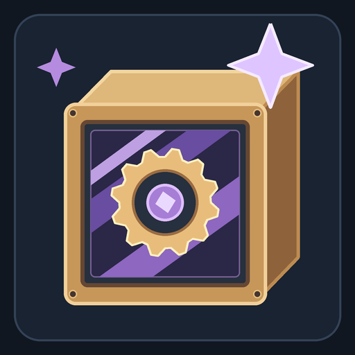

# Create Aero: Encased Enchantments

A Minecraft **1.21.1 / NeoForge** compatibility addon connecting **Create Encased** with **Create: Enchantable Machinery**.

Apply supported vanilla enchantments to Encased machines while retaining their casing models and original block/item IDs. Works independently of the Create Aero modpack when the required versions are installed.

- [CurseForge project](https://www.curseforge.com/minecraft/mc-mods/create-aero-encased-enchantments)
- [Report a bug](https://github.com/danelord91/create-aero-encased-enchantments/issues)
- [Build and test from source](docs/BUILDING.md)
- [Changelog](CHANGELOG.md)

## Supported machinery

75 built-in Encased variants across drills, saws, harvesters, ploughs, rollers, fans, mixers, presses and spouts. See [coverage.json](coverage.json) for exact item IDs and eligibility.

- **Efficiency:** drills, saws, ploughs, rollers, fans, mixers, presses and spouts. Speeds supported working actions, not a contraption's travel speed.
- **Fortune / Silk Touch:** drills, saws, harvesters and ploughs where the upstream behaviour and block loot tables use them.
- **Enchanting:** combine a supported machine with an enchanted book in an anvil. Normal Fortune/Silk Touch incompatibility applies.
- **Persistence:** retains enchantments through supported placement, recovery, save/reload and contraption capture/disassembly paths.
- **Shimmer:** casing glow when placed and carried on contraptions. The 0.2.1 carried-casing overlay uses Create's common path for Flywheel and fallback and respects CEM's `renderGlint` setting.

Shimmer covers baked casings, **not separately animated drill heads, blades, shafts or fluids**. Harvesters intentionally do not offer ineffective Efficiency. Third-party casing extensions and unrelated machinery are outside the verified scope.

## Required versions

| Component | Version |
| --- | --- |
| Minecraft | 1.21.1 |
| Java | 21 |
| NeoForge | 21.1.265 tested; minimum 21.1.265 |
| Create | 6.0.10 or newer |
| Create Encased | 1.10.0-fix1 or newer |
| Create: Enchantable Machinery | 3.6.0 or newer |

From addon 0.2.2, these three mod versions are inclusive minimum requirements, with no upper version cap. NeoForge also retains its existing minimum of 21.1.265. Minecraft stays locked to 1.21.1. This permits newer dependency versions to load; it does not certify their API, Mixin or gameplay compatibility. The tested dependency baseline remains Create 6.0.10, Create Encased 1.10.0-fix1 and Enchantable Machinery 3.6.0. Their own dependencies remain required. Other Minecraft versions and loaders are not supported by this build.

## Install

Back up your world. Close Minecraft and stop the server before replacing files. Install the addon JAR in `mods/` on **both client and multiplayer server**, alongside the required mods. Replace older addon versions rather than loading two at once. Single-player needs the JAR only in the instance's `mods/` folder.

This repository contains source, not the upstream mod binaries. For rebuilding and the required input hashes, see [BUILDING.md](docs/BUILDING.md).

### Uninstall caution

Encased ploughs use an addon-owned block entity to store enchantments while retaining their original IDs. Back up and recover enchanted machines before removing the addon; saved enchantments can otherwise be discarded. Enchanted items are not a substitute for keeping the addon installed when using this compatibility behaviour.

## Verification and limits

Version 0.2.2 passed **14 Python regression checks**, including actual Maven range acceptance/rejection checks, plus **22/22 development GameTests** and **22/22 production-JAR GameTests** using the pinned dependency baseline. Compared with 0.2.1, the only changed JAR entry is `META-INF/neoforge.mods.toml`; all compiled runtime classes and other resources are byte-identical. No newer dependency binary or fresh client visual run was tested for this metadata-only update.

Version 0.2.1 passed **22/22 production-JAR GameTests**, **8/8 glint-wiring checks** and **8/8 actual exported client-transformation checks**. The isolated client started successfully. The project owner also confirmed drill-casing shimmer on a contraption in-game.

The tests include all-variant anvil/placement/recovery and carried-enchantment selection, 45 moving-actor capture/disassembly cases and representative processing/loot behaviour. Controlled fixtures do not certify every powered contraption, loot table, shader, rendering backend or modpack. The owner's visual confirmation covers the reported drill/setup, not all variants or graphics configurations.

Raw development logs and temporary display packages are deliberately not committed. The test sources and isolated structure fixtures are included so checks can be rerun. A real client run is required before `verify_client_transforms.py`; these checks are not pixel tests.

## Credits and licence

Created for Dane Lord's Create Aero. This is an **independent addon**, not an official release of Create, Create Encased or Create: Enchantable Machinery.

- Create — the Creators of Create
- Create Encased — iglee42 and contributors
- Create: Enchantable Machinery — Cotrin and contributors

Addon code: [MIT licence](LICENSE). See [NOTICE](NOTICE) for attribution. Dependencies retain their own licences and are not redistributed here; the Gradle wrapper retains its notices.

The implementation and documentation were developed with AI assistance, automated regression tests and owner feedback.
